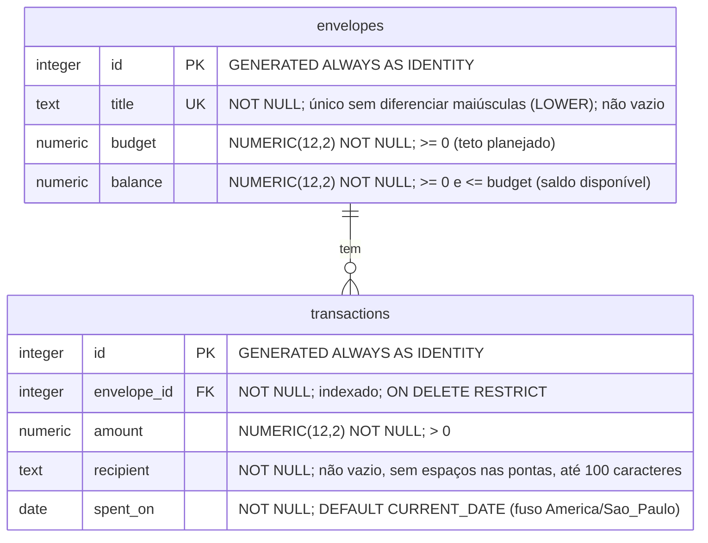

# Modelo de dados — Personal Budget

Decisões tomadas na etapa 1 do [ROADMAP](ROADMAP.md). Este documento descreve o modelo; o SQL fica em `db/schema.sql` (etapa 5).

## Diagrama



Um envelope tem zero ou mais transações; cada transação pertence a exatamente um envelope.

## Invariante

Para todo envelope, vale sempre:

```
budget − balance = soma de amount das transações do envelope
```

Toda operação que altera dinheiro preserva essa igualdade:

| Operação | `budget` | `balance` |
|---|---|---|
| Criar envelope | valor informado | igual ao `budget` |
| Editar `budget` (PUT) | novo valor | ajustado pela diferença (novo − antigo) |
| Transferir X de A para B | A −X, B +X | A −X, B +X |
| Criar transação de X | — | −X |
| Editar transação (X → Y) | — | −(Y − X); se trocar de envelope, devolve X ao antigo e debita Y do novo |
| Apagar transação de X | — | +X |

Como `amount > 0`, o invariante garante `balance <= budget`. O CHECK no banco existe só como rede de segurança.

O invariante envolve duas tabelas, então nenhuma constraint consegue garanti-lo. Para conferir, rode [`db/check-invariant.sql`](../db/check-invariant.sql): o resultado esperado é 0 linhas.

## Decisões e motivos

1. **`budget` e `balance` como colunas separadas.** O saldo é guardado, e não calculado, para que `CHECK (balance >= 0)` barre saldo negativo no próprio banco, inclusive com requisições concorrentes. O risco de divergência é controlado pelas transações SQL (`BEGIN`/`COMMIT`).
2. **`totalBudget` eliminado.** A regra "soma dos budgets ≤ total" envolve várias linhas, então nenhum CHECK consegue garanti-la sem travamento. `GET /` passa a mostrar só os totais alocado e disponível.
3. **Ids com `GENERATED ALWAYS AS IDENTITY`** em vez de `SERIAL`. É o padrão SQL e recusa ids inseridos manualmente por engano. `nextId` e `findEnvelopeIndex` deixam de existir.
4. **`envelope_id NOT NULL` e indexado.** Uma chave estrangeira aceita NULL por padrão, e o Postgres não indexa colunas de chave estrangeira automaticamente.
5. **`ON DELETE RESTRICT`.** O histórico financeiro não pode sumir em silêncio. O Postgres devolve o erro `23503`, que a API traduz em 409. As rotas de transações debitam o envelope antes de inserir: assim um envelope inexistente vira 404 antes de chegar à chave estrangeira, e o `23503` só aparece no DELETE de envelope.
6. **Transferências não têm tabela própria.** Elas só ajustam os envelopes. Uma tabela `transfers` fica como opcional (etapa 13).
7. **Colunas:**
   - `title` é único sem diferenciar maiúsculas (índice único sobre `LOWER(title)`).
   - `budget >= 0` tanto no POST quanto no PUT.
   - A coluna de data se chama `spent_on` em vez de `date`. `CURRENT_DATE` usa o fuso da sessão, que o Pool fixa em `America/Sao_Paulo` (o Render roda em UTC). O driver devolve `DATE` como texto `YYYY-MM-DD`, sem conversão para `Date` do JavaScript. A API recusa datas futuras.
   - O banco usa snake_case e o JSON usa camelCase, com o mapeamento centralizado numa função.
   - Valores monetários usam `NUMERIC(12,2)`, que o driver `pg` devolve como string.
